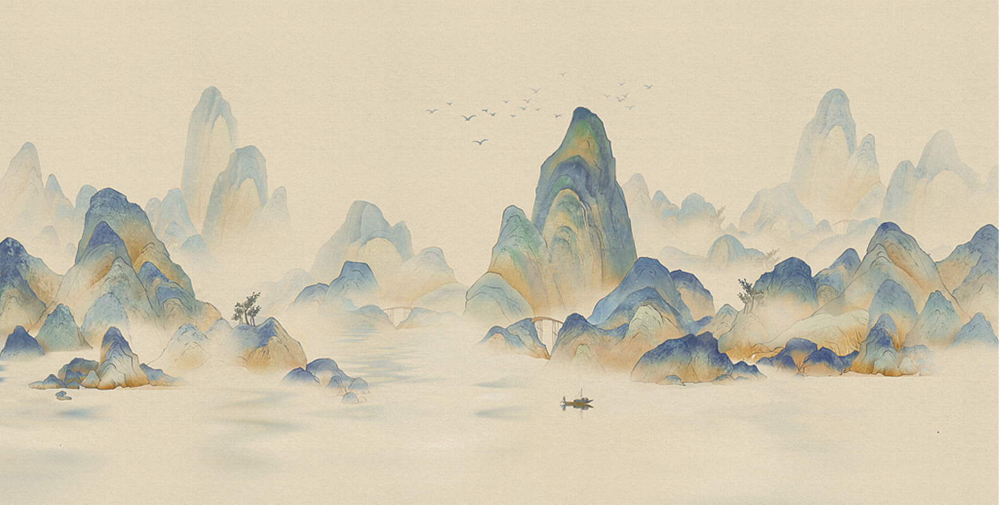

# Art-Of-Ink_TD · 手势交互水墨山水

基于 TouchDesigner 开发的交互式水墨山水数字艺术作品，目标是尽量复现 [Processing 原作 Art-Of-Ink](https://github.com/clouder118/Art-Of-Ink) 的视觉效果，并以笔记本摄像头捕捉的食指移动替代鼠标左键拖动。

本仓库独立承载 TD 版本的需求、任务、素材及后续开发。原 Processing 仓库继续作为原作基线；Liquid 仅是效果参考，不限定实现方式。

> **当前阶段：原型开发与实机验证。** 已在本机 TD 运行原山水图、摄像头手部识别和 GPU 水墨流动。用户已确认真实手势可以推动山水，并确认增强后的默认强度合适。稳定 60 FPS、迁移后的离线冷启动、完整视觉验收仍待完成；当前源码不代表已完成最终交付。

## 需求与开发任务

- [中文 PRD](docs/td-prd.md)：产品边界、30 条用户故事、模块设计、测试建议与验收环境。
- [开发任务拆分](docs/td-issues.md)：8 个完整功能切片、验收标准、依赖关系及人工参与环节。
- [工程技能配置](docs/agents/setup-proposal.md)：已生效的 GitHub Issues、分诊标签和后续开发约定。
- [PRD 父议题 #1](https://github.com/clouder118/Art-Of-Ink_TD/issues/1) · [开发任务 #2—#9](https://github.com/clouder118/Art-Of-Ink_TD/issues)：已发布，依赖关系和执行方式详见任务索引。

## 已确认的目标

- 保留原山水图的局部流动、惯性消散和原图恢复，允许与 Processing 存在实现细节差异。
- 食指伸直、其余三指收拢即可交互，拇指自然放松，允许适度倾斜。
- 镜像操作，左右手均可，每次一只手控制，另一只手不抢占。
- 手势失效或手离开镜头后停止新增推动，流体继续自然演化。
- 正式展示只显示山水；调试模式提供摄像头、手部状态与性能信息。
- 输出 1280 × 647，等比适配全屏；优先保证流畅度，以稳定 60 FPS 为优化目标。
- 《山居吟》启动后循环播放，支持静音。
- 打开 TD 工程即可体验，无需手动启动外部 Python；首次配置后支持离线冷启动。

## 目标运行环境

首版以 Windows、本机 TouchDesigner **2025.32820**、RTX 4060 Laptop GPU 和笔记本内置摄像头验收，使用场景为单人、正常室内光线。兼容性、离线启动、帧率及响应延迟均需开发中实测。

Processing 参考源码应使用 **Processing 3.5.4**；最新版 Processing 会因原项目的兼容性问题导致显示异常。此要求针对原作参考，与 TD 工程运行环境分别说明。

## 仓库结构

```text
Art-Of-Ink_TD/
├── README.md
├── AGENTS.md
├── docs/
│   ├── td-prd.md
│   ├── td-issues.md
│   └── agents/                # 技能配置记录、任务跟踪、标签与领域规则
├── TD/
│   └── assets/
│       ├── ink_painting3.png
│       └── 龚一 - 山居吟.mp3
└── references/
    └── processing/
        ├── README.md
        ├── project_5.pde
        └── data/addDensity.frag
```

`TD/` 包含原作素材、GPU 着色器、手势控制器、本地识别页面和可读构建脚本。MediaPipe 的 JS、WASM 和模型均随源码提供；运行时从本机加载。组件来源与许可见 [第三方说明](THIRD_PARTY_NOTICES.md)。

## 当前运行和开发

当前正在验证的工程使用 TouchDesigner **2025.32820**。最终 `.toe` 冷启动交付文件仍在整理，暂不要把开发中保存的工程当作最终发行版。

开发者先将一个空 TD 工程保存到本仓库的 `TD/` 目录，再在 Python Textport 执行 `TD/build_project.py` 构建节点。脚本需要在 TouchDesigner 内运行，普通 Python 不能创建 TD 节点。`TD/tools/install_dev_bridge.py` 仅用于本地开发，不应保留在交付工程中。

组件 `/artofink` 的自定义参数提供：`Debug` 调试画面、`Mute` 静音、`Gain` 推动强度（默认 **24**）、`Reset` 恢复原图、`Fullscreen` 全屏切换、`Restartcamera` 重启识别。正式展示画面仅显示山水，调试模式显示摄像头和状态。

自动测试可用 Python 3.11 执行：

```powershell
python -m unittest discover -s tests -v
```

目前 14 项测试覆盖手势判定、镜像方向、速度限制、重复帧、静止与失联、单手独占与安全接管，以及随包离线资源的完整性。真实视觉、帧率和冷启动测试记录见 [开发验证记录](docs/development-validation.md)。

## 山水原图



开源流体与手势识别的候选资料见 PRD。实际采用第三方代码或组件时，应记录版本、来源并保留相应许可说明。
